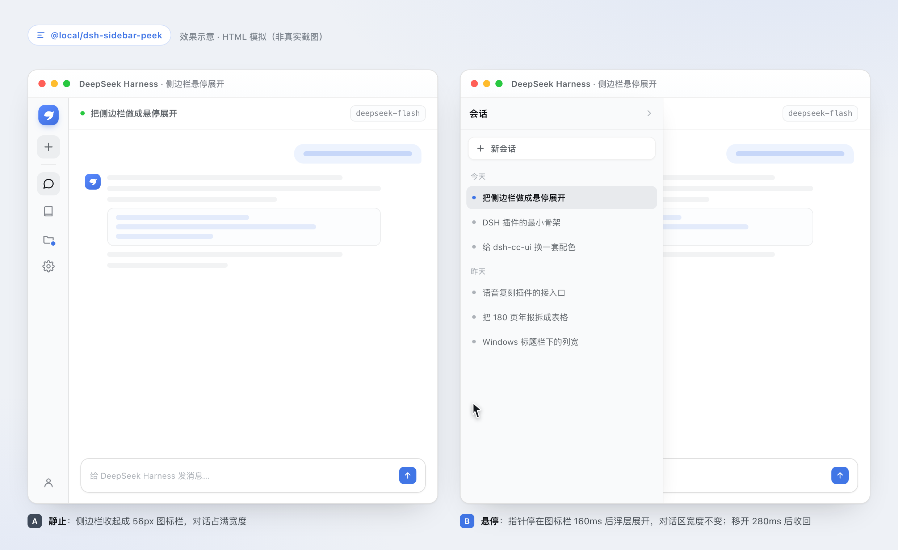

<p align="center">
  
</p>

<h1 align="center">dsh-sidebar-peek</h1>

<p align="center"><b>An Edge-style left sidebar for DeepSeek Harness: a narrow icon rail at rest, the full sidebar only while the pointer rests on it.</b></p>

<div align="center">

[简体中文](README.zh-CN.md) · [GitHub](https://github.com/Sunshine334419520/dsh-sidebar-peek) · [Preview](#preview) · [States](#states) · [Interaction](#interaction-rules) · [How it works](#how-it-works) · [Install](#installation) · [Tuning](#tuning) · [Compatibility](#compatibility)

[](https://github.com/deepseek-ai/deepseek-harness)
[](package.json)
[](#how-it-works)
[](package.json)

</div>

> A community plugin for [DeepSeek Harness](https://github.com/deepseek-ai/deepseek-harness). Not an official DeepSeek product.

DSH's sidebar is either 280px wide or collapsed to a 56px rail you have to click open. This plugin makes the rail behave like Edge's: it stays out of the way, expands into a floating sidebar as soon as the pointer rests on it, and gets out of the way again when the pointer leaves — without ever moving the conversation.

## Preview



<sub>Left: at rest, 56px rail. Right: hovered, the sidebar floats over the session list; the conversation keeps its width. The picture was drawn in `docs/preview.html` and rendered with headless Edge, not captured from a live app — see [Compatibility](#compatibility).</sub>

## Features

- **Collapsed at rest** — 56px rail on the Web layout; on the macOS desktop build the host has no rail at all, so a 6px hot edge on the left screen border takes over. See [Compatibility](#compatibility).
- **Overlay expansion** — the sidebar floats above the conversation at 280px (or the width you last dragged it to). The conversation does not reflow, re-wrap or jump.
- **Two-way collapse** — leaving the sidebar collapses it after a grace period; `Esc`, window blur, resize or a click outside collapse it at once.
- **Manual control still wins** — clicking the rail's own toggle pins the sidebar open, and hover never fights you back. After `Esc` or an outside click, auto-open stays off until the pointer leaves the rail.
- **Politeness rules** — no expansion while dragging the sidebar edge, while a dialog or menu is open, while the window is unfocused, in drawer mode (<768px), or on touch devices (`hover: none`).
- **Theme-token styling** — the opaque fill, border, shadow and timing come from `--dsw-*` / `--ds-*` variables, so dark mode and the font-size setting carry over.
- **Client-only** — one bundle, an empty host half, no runtime dependencies, no network calls, no storage of its own.

## States

| State | Trigger | Result |
| --- | --- | --- |
| At rest | Page load / pointer leaves | Collapses to the 56px rail, or to the left-edge hot zone on the macOS desktop build |
| Hovered | Pointer rests on the rail (or hot zone) for 160ms | Floating sidebar at 280px or the last dragged width; conversation stays put |
| Pinned | Click the rail's own toggle | Stays expanded until you collapse it yourself |

## Interaction rules

Collapse: 280ms after the pointer leaves the sidebar, immediately on `Esc`, window blur, window resize, or a pointer-down outside it.

Do not expand: drawer mode (viewport < 768px), while the sidebar edge is being dragged, while a dialog / menu / listbox is open, while the window is unfocused, on `hover: none` devices.

Manual priority: after the rail toggle is clicked — or after `Esc` / an outside click — auto-open is suppressed until the pointer leaves the rail. A sidebar you expanded yourself is never collapsed automatically.

During a hover peek the host's resize handle is disabled; otherwise the `col-resize` cursor would sit on the floating panel and a drag would pin the sidebar open behind it.

## How it works

CSS alone cannot do this. When the sidebar collapses, the host **unmounts** the wide content 150ms after the animation settles — the rail has no session list to reveal, no matter how you style it. Expansion therefore has to go through layout state, and the plugin uses exactly one public action:

```js
ctx.layout.toggleSidebar()   // collapsed ⟷ expanded, the same path a manual click takes
```

`overlay` mode (the default) stacks the floating sidebar like this:

1. Before expanding, the frame's own inline `gridTemplateColumns` is copied into `--dsh-peek-grid` and pinned with `[data-dsh-peek]{grid-template-columns:var(--dsh-peek-grid)!important}`, so the grid keeps its collapsed columns and the conversation cannot move.
2. The sidebar column is tagged `data-dsh-peek-col` and lifted out of the grid: `position:absolute`, `inset:0 auto auto 0`, width and height taken from the expansion target, `z-index:40`, plus an opaque background, a right border and a shadow. The macOS build's sidebar is a translucent vibrancy layer — floating it over text without the opaque fill makes the session list unreadable.
3. On collapse the column is first squeezed back to rail width, and every marker is removed 320ms later so the host's own fade finishes first. The peek width is read from the React-committed inline width (`element.style.width`), not from the animated box, so a peek can never freeze half-open.

`push` mode skips the markers and lets the host's normal in-flow expansion run — the conversation gives way instead of being covered.

The only DOM the plugin adds is two data attributes and a few CSS variables. No host stylesheet is patched, no host component is replaced: a future DSH release can at worst make the peek stop working, not break the shell.

## Requirements

- DeepSeek Harness `0.2.2-rc.3` or newer (Web UI of the Web or desktop build; the layout contract it uses is the `0.2.2` one).
- A layout service that exposes `toggleSidebar()` — that is `@deepseek-ai/dsh-client-ui-layout` as shipped.
- No Node.js requirement beyond the DSH runtime; no API keys, no network access.

## Installation

### Ask an agent

Send this to any agent that can run terminal commands. Replace `desktop` with your profile name (`dsh profiles` lists them):

```text
Install the local DSH plugin at /absolute/path/to/dsh-sidebar-peek into my desktop profile,
then tell me to refresh the page. It should collapse the sidebar to an icon rail at rest
and expand it as a floating panel while the pointer rests on it.
```

### From source

```bash
git clone https://github.com/Sunshine334419520/dsh-sidebar-peek.git
dsh plugin --profile desktop add /absolute/path/to/dsh-sidebar-peek
```

Or, from a workspace without publishing anything:

```bash
dsh plugin --profile desktop add "$PWD"
```

The package is `private: true` and is not published to npm — install it from a path, or ask an agent to call `plugin_manager` with the bundle's absolute directory.

### Reload

The package is installed as a `link:`, so editing `client.js` needs **no reinstall** — refresh the page. Toggling the plugin off and on in **Plugins** is only needed if the module failed to load.

### Verify

Open the Web UI. The sidebar should sit as an icon rail at load. Hover it: it floats open. Move the pointer away: it collapses. The console logs one line on activation:

```text
[sidebar-peek] active { mode: 'overlay', startCollapsed: true }
```

## Usage

Rest the pointer on the rail until the sidebar floats open, then click through sessions, workspaces and panels as usual. Click the rail's top toggle to pin it open — that is the host's own control, and it behaves exactly as before this plugin.

To keep the sidebar collapsed when the page loads, keep `startCollapsed` at its default `1`; set it to `0` and the plugin leaves the start-up state alone.

## Tuning

Read once at activation from `localStorage`; reload to apply.

| Key | Default | Meaning |
| --- | --- | --- |
| `dsh-sidebar-peek:mode` | `overlay` | `overlay` floats the sidebar; `push` uses the host's in-flow expansion |
| `dsh-sidebar-peek:delay` | `160` | Hover delay before expanding (ms) |
| `dsh-sidebar-peek:leaveDelay` | `280` | Grace period before collapsing (ms) |
| `dsh-sidebar-peek:startCollapsed` | `1` | Collapse on load; `0` leaves the start-up state alone |

```js
localStorage.setItem('dsh-sidebar-peek:mode', 'push')
localStorage.setItem('dsh-sidebar-peek:leaveDelay', '500')
location.reload()
```

Removing a key restores the default.

## Compatibility

- **The macOS desktop build has no rail.** The host sets the collapsed column width to `0` there and keeps its reopen control in the leading seat next to the traffic lights (`--dsh-frame-leading-clearance: 160px`). The plugin does not fight that design: on darwin the 6px hot edge on the left screen border is the trigger. The 56px rail appears in a browser-hosted DSH Web (non-darwin layout).
- **Host-initiated changes win.** If the host changes the collapsed state on its own — narrow window, a switch to drawer mode — the plugin drops the peek and follows instead of toggling back.
- **The conversation keeps its width** during a peek, so a host layout change made *during* a peek (opening the right panel, for example) is only fully visible once the peek ends.
- **The screenshot is a mock.** This plugin was authored without browser automation, so `docs/preview.png` is drawn from the host's real color tokens in `docs/preview.html`, not captured from a running app. Behaviour was reviewed against the host sources (`AppFrame.tsx`, `AppFrame.module.css`, `SidebarRoot.tsx`) and `node --check`-ed; pixel-level verification is yours.

## Files

| File | Purpose |
| --- | --- |
| `client.js` | All behaviour: pointer rules, overlay mount/release, listeners and their cleanup |
| `index.js` | Host half, deliberately empty |
| `cordis.patch.yml` | Bundle insert declaration |
| `locale/en.json`, `locale/zh.json` | Plugin metadata for the plugin list |
| `docs/preview.html` | The drawing behind the preview image |
| `docs/preview.png` | The rendered preview used above |

## Troubleshooting

| Symptom | Fix |
| --- | --- |
| Nothing happens on hover | The viewport is in drawer mode (<768px), the device is touch (`hover: none`), or the plugin did not load — check the `[sidebar-peek] active` console line |
| Sidebar expands but the conversation also moves | That is `push` mode; remove `dsh-sidebar-peek:mode` or set it to `overlay` |
| Sidebar is expanded on load | Expected with `startCollapsed=1` — the plugin collapses it once, right after mount; set `0` to keep the host's start-up state |
| Peek closes on its own | A dialog/menu was open, or the window lost focus; widen `leaveDelay` if the pointer leaves briefly |
| Sidebar cannot be resized during a peek | Intentional — the resize handle is disabled while the panel floats |
| Peek never appears on macOS desktop | There is no rail on that platform; hover the left screen border instead |

## Development

```bash
git clone https://github.com/Sunshine334419520/dsh-sidebar-peek.git
dsh plugin --profile desktop add "$PWD"
```

Plain ESM, no build step, no runtime dependencies. `client.js` is a Cordis client module loaded through `window.__ModuleLoader__`; `index.js` is the host half. After editing, refresh the page; re-enable the plugin in **Plugins** only if the module threw.

Regenerate the preview:

```bash
"/Applications/Microsoft Edge.app/Contents/MacOS/Microsoft Edge" \
  --headless=new --hide-scrollbars --force-device-scale-factor=2 \
  --window-size=1240,760 --screenshot=docs/preview.png \
  "file://$PWD/docs/preview.html"
```
