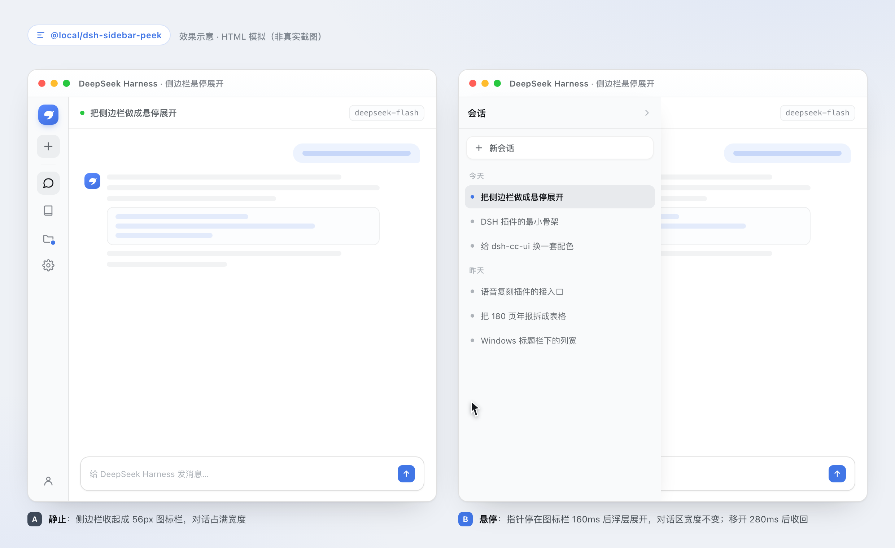

<p align="center">
  
</p>

<h1 align="center">dsh-sidebar-peek</h1>

<p align="center"><b>给 DeepSeek Harness 的 Edge 式左侧边栏：静止时是一条图标栏，指针停上去才浮出完整侧边栏。</b></p>

<div align="center">

[English](README.md) · [GitHub](https://github.com/Sunshine334419520/dsh-sidebar-peek) · [预览](#预览) · [状态](#状态) · [交互判定](#交互判定) · [实现](#实现) · [安装](#安装) · [可调参数](#可调参数) · [兼容与限制](#兼容与限制)

[](https://github.com/deepseek-ai/deepseek-harness)
[](package.json)
[](#实现)
[](package.json)

</div>

> 这是 [DeepSeek Harness](https://github.com/deepseek-ai/deepseek-harness) 的社区插件，不是 DeepSeek 官方产品。

DSH 的侧边栏只有两种形态：280px 宽，或者收成 56px 图标栏等你点开。这个插件让图标栏像 Edge 那样工作——平时不占地方，指针一停上去就浮出完整侧边栏，移开就收回去，而且整个过程不会让对话区动一下。

## 预览



<sub>左：静止，56px 图标栏。右：悬停，侧边栏浮在会话列表之上，对话区宽度不变。这张图是用 `docs/preview.html` 画出来后用无头 Edge 渲染的，不是真机截图，原因见 [兼容与限制](#兼容与限制)。</sub>

## 特性

- **静止即收起** —— Web 布局下是 56px 图标栏；macOS 桌面版宿根本没有图标栏，改由屏幕左缘 6px 热区接管。见 [兼容与限制](#兼容与限制)。
- **浮层展开** —— 侧边栏浮在对话之上，宽 280px（或你上次拖出的宽度）。对话区不重排、不换行、不跳动。
- **双向收起** —— 指针离开后宽限一小段时间再收起；`Esc`、窗口失焦、窗口 resize、点击侧边栏以外区域则立刻收起。
- **手动优先** —— 点图标栏顶部的开关就是「固定展开」，悬停不会跟你抢。按过 `Esc` 或点过外面之后，在指针离开图标栏之前不会再自动展开。
- **该忍的时候忍** —— 拖拽列宽中、有对话框 / 菜单打开、窗口未聚焦、抽屉模式（<768px）、触屏（`hover: none`）都不展开。
- **跟随主题** —— 不透明底色、描边、投影、动效时长都取 `--dsw-*` / `--ds-*` 变量，暗色主题与字号设置一并跟随。
- **纯 Client 侧** —— 一个 bundle，宿主半边空实现，零运行时依赖，不联网，不自建存储。

## 状态

| 状态 | 触发 | 结果 |
| --- | --- | --- |
| 静止 | 页面加载 / 指针离开 | 收成 56px 图标栏；macOS 桌面版收成 0 宽，改用左缘热区 |
| 悬停 | 指针在图标栏（或热区）停 160ms | 浮层展开到 280px 或上次拖出的宽度，对话区不动 |
| 固定 | 点图标栏顶部的开关 | 保持展开，直到你自己收起 |

## 交互判定

收起：指针离开侧边栏 280ms 后；`Esc`、窗口失焦、窗口 resize、在侧边栏以外按下指针则立刻收起。

不展开：抽屉模式（视口 < 768px）、正在拖拽列宽、有对话框 / 菜单 / 列表弹层打开、窗口未聚焦、`hover: none` 设备。

手动优先：点过图标栏开关之后（或按过 `Esc`、点过外面），在指针离开图标栏之前不再自动展开；而你自己展开的侧边栏，永远不会被自动收起。

浮层期间宿主自带的列宽拖拽手柄会被禁用——否则 `col-resize` 光标会落在浮层上，一次拖拽就会把侧边栏在浮层背后钉成展开。

## 实现

纯 CSS 做不到。宿主收起侧边栏时，会在动画结束 150ms 后把侧边栏的宽内容**卸载**掉——图标栏里根本没有会话列表可供「显示」，再怎么调样式也是空的。所以展开必须走宿主的布局状态，而插件只用公开的那一个动作：

```js
ctx.layout.toggleSidebar()   // 收起 ⟷ 展开，和手动点开关完全同一条路径
```

`overlay` 模式（默认）这样把浮层叠出来：

1. 展开前把 frame 上那行 `gridTemplateColumns` 原样存进 `--dsh-peek-grid`，再用 `[data-dsh-peek]{grid-template-columns:var(--dsh-peek-grid)!important}` 把网格钉在收起时的列宽上，对话区因此一步都不动。
2. 给侧边栏列打上 `data-dsh-peek-col`，把它从网格里抬出来：`position:absolute`、`inset:0 auto auto 0`、宽高取展开目标、`z-index:40`，再补一层不透明底色、右描边和投影。macOS 桌面版的侧边栏本来是窗口 vibrancy 做的半透明层，直接浮在正文上会透字。
3. 收起时先把列宽压回图标栏宽度，320ms 后再摘掉所有标记，让宿主的淡出先跑完。浮层宽度读的是 React 提交的那行行内宽度（`element.style.width`），不是动画途中的盒子宽度，所以不会停在半路。

`push` 模式不叠浮层，直接用宿主原本的挤压式展开——对话区会跟着让位。想要传统手感就切过去。

插件对 DOM 的全部改动只有两个 data 属性和几个 CSS 变量。它不修改宿主的样式表，也不替换宿主的组件：将来 DSH 升级，最坏的结果是浮层失效，而不是整个界面白屏。

## 环境要求

- DeepSeek Harness `0.2.2-rc.3` 或更新（Web 版或桌面版的 Web UI 均可；它依赖的是 `0.2.2` 这版布局契约）。
- 一个暴露 `toggleSidebar()` 的布局服务，即随包发布的 `@deepseek-ai/dsh-client-ui-layout`。
- 除 DSH 运行时外不需要 Node.js；不需要 API Key，不访问网络。

## 安装

### 让 Agent 帮你装

把下面这段发给任何能执行终端命令的 Agent，把 `desktop` 换成你的 profile 名（`dsh profiles` 可列出）：

```text
把 /绝对路径/dsh-sidebar-peek 这个本地 DSH 插件装进我的 desktop profile，
装完告诉我刷新页面。它应该让侧边栏平时收成图标栏，指针停上去时浮层展开。
```

### 从源码安装

```bash
git clone https://github.com/Sunshine334419520/dsh-sidebar-peek.git
dsh plugin --profile desktop add /绝对路径/dsh-sidebar-peek
```

或者不发布、直接指向工作目录：

```bash
dsh plugin --profile desktop add "$PWD"
```

包是 `private: true`，没有发布到 npm——请从路径安装，或让 Agent 用 `plugin_manager` 指向 bundle 的绝对目录。

### 重载

包以 `link:` 方式安装，所以改完 `client.js` **不需要重装**，刷新页面即可。只有在模块加载失败时，才需要去「插件」里关掉再打开。

### 验证

打开 Web UI：加载时侧边栏应该是一条图标栏，悬停后浮出，移开收回。激活时控制台会打一行：

```text
[sidebar-peek] active { mode: 'overlay', startCollapsed: true }
```

## 使用

把指针停在图标栏上，等侧边栏浮出，然后照常点会话、工作区、各个面板。点图标栏顶部的开关就是「固定展开」——那是宿主自己的控件，行为和装插件之前一模一样。

想让页面加载时保持展开，把 `startCollapsed` 设成 `0`，插件就不去动启动时的状态。

## 可调参数

在激活时从 `localStorage` 读一次，改完刷新生效。

| 键 | 默认值 | 说明 |
| --- | --- | --- |
| `dsh-sidebar-peek:mode` | `overlay` | `overlay` 浮层展开；`push` 用宿主原本的挤压式展开 |
| `dsh-sidebar-peek:delay` | `160` | 悬停多久后展开（毫秒） |
| `dsh-sidebar-peek:leaveDelay` | `280` | 离开多久后收起（毫秒） |
| `dsh-sidebar-peek:startCollapsed` | `1` | 加载后是否主动收起；`0` 保持启动时的原状 |

```js
localStorage.setItem('dsh-sidebar-peek:mode', 'push')
localStorage.setItem('dsh-sidebar-peek:leaveDelay', '500')
location.reload()
```

删除键即回到默认值。

## 兼容与限制

- **macOS 桌面版没有图标栏**。宿主在收起时把这一列宽度定为 `0`，把展开按钮放在红绿灯旁边那条带上（`--dsh-frame-leading-clearance: 160px`）。插件不跟平台设计对着干：在 darwin 上由屏幕左缘 6px 热区触发。56px 图标栏出现在浏览器里打开的 DSH Web（非 darwin 布局）。
- **宿主优先**。宿主自己改变收起状态时（窗口变窄、切到抽屉模式），插件立刻放弃浮层并跟随，不会反向操作。
- **浮层期间对话区宽度不变**，所以这期间宿主做的布局变更（比如打开右侧面板）要等浮层结束才能完整看到。
- **截图是模拟的**。这个插件是在没有浏览器自动化的会话里写成的，`docs/preview.png` 是用宿主的真实配色在 `docs/preview.html` 里画出来再渲染的，不是从运行中的界面截的。行为对照宿主源码（`AppFrame.tsx`、`AppFrame.module.css`、`SidebarRoot.tsx`）审查过，也过了 `node --check`；像素级验证需要你自己看一眼。

## 文件

| 文件 | 说明 |
| --- | --- |
| `client.js` | 全部行为：指针判定、浮层挂载 / 拆卸、监听器与清理 |
| `index.js` | 宿主半边，故意留空 |
| `cordis.patch.yml` | bundle 插入声明 |
| `locale/en.json`、`locale/zh.json` | 插件列表用的元数据 |
| `docs/preview.html` | 预览图的绘制源文件 |
| `docs/preview.png` | 上面用的渲染结果 |

## 疑难

| 现象 | 处理 |
| --- | --- |
| 悬停没反应 | 视口处于抽屉模式（<768px）、设备是触屏（`hover: none`），或插件没加载——看控制台有没有 `[sidebar-peek] active` |
| 侧边栏展开了，但对话区也跟着动 | 这就是 `push` 模式；删掉 `dsh-sidebar-peek:mode` 或设为 `overlay` |
| 页面加载时侧边栏是展开的 | `startCollapsed=1` 时属预期——插件挂载后会收一次；设 `0` 则保持宿主原状 |
| 浮层自己收回了 | 有对话框 / 菜单打开，或窗口失焦；指针只是短暂离开的话把 `leaveDelay` 调大 |
| 浮层期间拖不动侧边栏宽度 | 有意为之——浮层期间禁用列宽拖拽 |
| macOS 桌面版怎么试都没有浮层 | 该平台没有图标栏；把指针移到屏幕左缘再试 |

## 开发

```bash
git clone https://github.com/Sunshine334419520/dsh-sidebar-peek.git
dsh plugin --profile desktop add "$PWD"
```

纯 ESM，无构建步骤，无运行时依赖。`client.js` 是经 `window.__ModuleLoader__` 加载的 Cordis Client 模块，`index.js` 是宿主半边。改完刷新页面；只有模块抛错时才需要去「插件」里重新启用。

重新生成预览图：

```bash
"/Applications/Microsoft Edge.app/Contents/MacOS/Microsoft Edge" \
  --headless=new --hide-scrollbars --force-device-scale-factor=2 \
  --window-size=1240,760 --screenshot=docs/preview.png \
  "file://$PWD/docs/preview.html"
```
